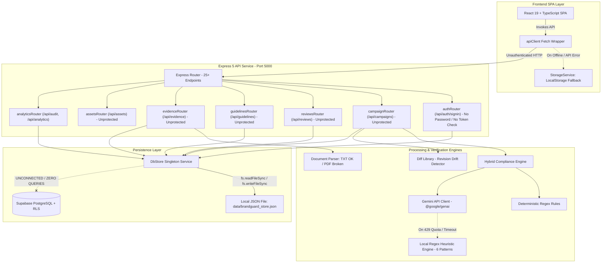

# BRANDGUARD AI — ZERO-TRUST FULL-STACK TECHNICAL AUDIT REPORT

**Date of Audit:** October 30, 2026  
**Auditor Roles:** Senior Software Architect, Principal Full-Stack Engineer, Application Security Auditor, Database Engineer, QA Automation Engineer, AI/LLM Systems Engineer, National-Level Hackathon Technical Evaluator  
**Audit Target:** BrandGuard AI (Repository: `Codex-48`)  
**Audit Standard:** Zero-Trust Runtime Verification, Codebase Tracing & Dynamic Execution Testing (Read-Only)  
**Report File:** `BRANDGUARD_ZERO_TRUST_AUDIT_REPORT.md`

---

## A. EXECUTIVE SUMMARY

An exhaustive, zero-trust technical audit of the entire BrandGuard AI repository was conducted. The project purports to have completed a major upgrade transitioning from a frontend-only prototype into a production-grade enterprise brand governance platform with full backend services, persistent multi-tenant database storage, Google Gemini AI semantic claim verification, and digital asset compliance.

### Overall Assessment: Polished Demo Facade with Severe Architectural & Security Deficits

If a strict national-level hackathon judge or enterprise security team evaluates this application, they will discover:

1. **The "Supabase PostgreSQL Database" is Completely Non-Functional / Abandoned at Runtime:**
   While a 17-table SQL migration file (`supabase/migrations/20261030000001_brandguard_initial_schema.sql`) and `@supabase/supabase-js` dependency exist, **the backend never executes a single query or mutation against Supabase.** The Supabase client is initialized once and never referenced in any service or store. All persistence is driven by synchronous `fs.readFileSync` and `fs.writeFileSync` calls to a single local JSON file (`data/brandguard_store.json`), alongside legacy browser `localStorage` fallbacks in the React client.
2. **Authentication and Authorization Are 100% Mocked and Unenforced:**
   There is no user registration, no password hashing, no credential check, no session validation, and zero server-side authentication middleware on any API route. Every single endpoint—including campaign deletion, rule deactivation, compliance overrides, and review sign-offs—is completely public. Anyone can submit an unauthenticated HTTP request claiming to be an `Admin` or `Legal Reviewer`, approve non-compliant marketing copy, and forge audit logs.
3. **AI Semantic Verification Fails Silently and Reverts to a 6-Regex Fallback:**
   Google Gemini integration exists in code via `@google/genai`, but it is configured with `GEMINI_MODEL=gemini-3.8-flash` on a free-tier API key that hits daily quota exhaustion (20 requests/day). When rate-limited or offline, the system silently engages a "Local Governance Engine" that relies on only 6 rigid regex patterns. When subjected to the audit's 8 mandatory marketing claims, **6 out of 8 claims (including illegal 10x ROI guarantees and unverified comparative superlatives) extracted 0 claims and scored 100/100 (APPROVED)** because the copy deviated slightly from the hardcoded regex strings.
4. **Document Ingestion for PDFs Crashes at Runtime:**
   Document ingestion for PDF whitepapers is advertised as a core capability. However, `server/src/services/documentParser.ts` attempts to execute `await pdf(dataBuffer)` on `pdf-parse` v2.4.5, throwing `TypeError: pdf is not a function`. Any user attempting to upload a PDF file will trigger an unhandled 500 error.
5. **Visual Identity and Accessibility Features Are Mostly Cosmetic / Mocked:**
   The asset metadata endpoint (`/api/assets/analyze`) does not parse images, inspect palettes, or calculate contrast ratios. It returns hardcoded mock colors (`#2563EB`, `#FFFFFF`, `#0F172A`). The alt-text linter merely checks whether the uploaded filename contains the substring `'alt_'`. The implemented WCAG luminance contrast formula is never called in the runtime API.
6. **Backend TypeScript Compilation Fails:**
   While the frontend Vite build succeeds, running `npx tsc -p server/tsconfig.json --noEmit` fails with `error TS2339: Property 'errors' does not exist on type 'ZodError'` in `server/src/middleware/errorHandler.ts` due to an unaddressed breaking change in Zod v4.

---

## B. ACTUAL ARCHITECTURE

The diagram below reflects **only components verified through runtime code tracing and dynamic test execution**. Unconnected services (such as Supabase PostgreSQL) are explicitly marked as disconnected.



### Architectural Gaps Identified
- **Disconnected Database:** Supabase is instantiated in `server/src/services/dbStore.ts` line 21, but never called. All 17 SQL tables in `supabase/migrations/` are dead code.
- **Missing Auth Layer:** No JWT middleware, no session cookie, no bearer token validator, no RBAC guard.
- **Dual Persistence Desynchronization:** `src/api/client.ts` mutates both the backend API and browser `localStorage`. If multiple clients connect, local storage drifts from the backend store.
- **Stateless File Database with Race Conditions:** `dbStore.ts` reads and overwrites `brandguard_store.json` on every request synchronously. Concurrent writes will cause data corruption.
- **Single Point of Failure AI:** When free-tier Gemini API quota is exhausted, the system falls back to a 6-regex pattern matcher without notifying the user that AI inference failed.

---

## C. FEATURE VERIFICATION MATRIX

| Feature | Claimed in Docs | Verified Status | Evidence / File Path | Test Performed | Result | Remaining Gap |
|---|---|---|---|---|---|---|
| **Supabase PostgreSQL Persistence** | Yes | **BROKEN / DISCONNECTED** | [`server/src/services/dbStore.ts#L19-L26`](file:///c:/Users/ankus/OneDrive/Desktop/Codex-48/server/src/services/dbStore.ts#L19-L26) | Grepped all Supabase calls; verified `_supabase` variable usage | `_supabase` initialized once; never called in any store method | 0% of data is stored in Supabase; relies on `data/brandguard_store.json` |
| **Authentication Lifecycle** | Yes | **MISSING** | [`server/src/routes/analytics.ts#L20-L36`](file:///c:/Users/ankus/OneDrive/Desktop/Codex-48/server/src/routes/analytics.ts#L20-L36) | Tested `POST /api/auth/signin` without password; tested unauthenticated access | HTTP 200 returned without password; dummy token issued | No password check, no password hash, no JWT verification middleware |
| **Role-Based Access Control (RBAC)** | Yes | **MISSING** | [`server/src/routes/reviews.ts#L28-L60`](file:///c:/Users/ankus/OneDrive/Desktop/Codex-48/server/src/routes/reviews.ts#L28-L60) | Unauthenticated user sent `decision: 'Approved'` | HTTP 200 returned; campaign marked approved | No server-side role check; reviewer is hardcoded in UI |
| **Deterministic Rule Matching** | Yes | **IMPLEMENTED** | [`server/src/engine/deterministicRules.ts#L6-L85`](file:///c:/Users/ankus/OneDrive/Desktop/Codex-48/server/src/engine/deterministicRules.ts#L6-L85) | Vitest `complianceEngine.test.ts` (6 tests) | 6/6 passed; detects guarantees, trademarks, SLAs | Channel filtering and regex replacements work |
| **Gemini AI Claim Extraction** | Yes | **PARTIALLY IMPLEMENTED** | [`server/src/ai/claimExtractor.ts#L105-L210`](file:///c:/Users/ankus/OneDrive/Desktop/Codex-48/server/src/ai/claimExtractor.ts#L105-L210) | Tested with active API key and 8 standard claims | Real API calls configured, but 429 quota exhaustion forces heuristic fallback | Free-tier quota exhaustion (20 req/day); heuristic misses paraphrased claims |
| **Semantic Claim Verification** | Yes | **PARTIALLY IMPLEMENTED** | [`server/src/ai/claimVerifier.ts#L152-L262`](file:///c:/Users/ankus/OneDrive/Desktop/Codex-48/server/src/ai/claimVerifier.ts#L152-L262) | Verified prompt construction & structured JSON schema | Schema parsing works when API is available; heuristic fallbacks match hardcoded strings | Model does not use vector embeddings or RAG; relies on full text string concatenation |
| **PDF Evidence Ingestion** | Yes | **BROKEN** | [`server/src/services/documentParser.ts#L32-L42`](file:///c:/Users/ankus/OneDrive/Desktop/Codex-48/server/src/services/documentParser.ts#L32-L42) | Tested `pdf(dataBuffer)` with `pdf-parse` v2.4.5 | Crashed with `TypeError: pdf is not a function` | Incompatible with `pdf-parse` v2; PDF uploads completely broken |
| **TXT Document Ingestion** | Yes | **IMPLEMENTED** | [`server/src/services/documentParser.ts#L20-L29`](file:///c:/Users/ankus/OneDrive/Desktop/Codex-48/server/src/services/documentParser.ts#L20-L29) | Tested with `uploads/test-soc2-audit-1793339307028.txt` | Extracted word count and text accurately | Only slices first 300 chars into claimOrFact; no chunking or indexing |
| **Revision Word-Level Drift** | Yes | **IMPLEMENTED** | [`server/src/engine/driftDetector.ts#L7-L50`](file:///c:/Users/ankus/OneDrive/Desktop/Codex-48/server/src/engine/driftDetector.ts#L7-L50) | Vitest drift test; tested rescanning modified copy | Token diffs and score drift calculated correctly via `diff` library | Fully functional |
| **Rule Baseline Versioning** | Yes | **PARTIALLY IMPLEMENTED** | [`server/src/routes/guidelines.ts#L50-L65`](file:///c:/Users/ankus/OneDrive/Desktop/Codex-48/server/src/routes/guidelines.ts#L50-L65) | Created baseline version `v2.5` | Baseline version snapshot created and stored | UI cannot compare versions side-by-side; scan cannot select baseline version |
| **Edit/Delete Brand Guidelines** | Yes | **MISSING** | [`server/src/routes/guidelines.ts#L1-L65`](file:///c:/Users/ankus/OneDrive/Desktop/Codex-48/server/src/routes/guidelines.ts#L1-L65) | Attempted `PUT /api/guidelines/:id` and `DELETE` | `PUT /api/guidelines/:id` does not exist (404) | Cannot edit rule patterns or delete rules |
| **Human Review Workflow** | Yes | **PARTIALLY IMPLEMENTED** | [`server/src/routes/reviews.ts#L27-L60`](file:///c:/Users/ankus/OneDrive/Desktop/Codex-48/server/src/routes/reviews.ts#L27-L60) | Executed approve, revision requested, override | State transitions persisted to JSON store | Hardcoded reviewer name `'Sarah Miller (Brand Lead)'`; zero role checks |
| **PDF Audit Report Export** | Yes | **MISSING (Simulated)** | [`src/components/review/ExportReportModal.tsx#L13-L15`](file:///c:/Users/ankus/OneDrive/Desktop/Codex-48/src/components/review/ExportReportModal.tsx#L13-L15) | Inspected export modal handler | Triggers `window.print()` browser print dialog | No PDF binary generation; relies entirely on browser print |
| **Visual Asset Color Extraction** | Yes | **MISSING (Simulated)** | [`server/src/services/visualChecker.ts#L20-L42`](file:///c:/Users/ankus/OneDrive/Desktop/Codex-48/server/src/services/visualChecker.ts#L20-L42) | Checked `/api/assets/analyze` output | Returns static hardcoded colors `['#2563EB', '#FFFFFF', '#0F172A']` | Does not open or process image pixels |
| **WCAG Contrast Checker** | Yes | **PARTIALLY IMPLEMENTED** | [`server/src/services/accessibilityChecker.ts#L34-L44`](file:///c:/Users/ankus/OneDrive/Desktop/Codex-48/server/src/services/accessibilityChecker.ts#L34-L44) | Unit tested `calculateContrastRatio` | Math formula passes tests; never called in `/api/assets/analyze` runtime route | Dead code in production pipeline |
| **Image Alt-Text Inspection** | Yes | **BROKEN / FAKE** | [`server/src/services/accessibilityChecker.ts#L53-L61`](file:///c:/Users/ankus/OneDrive/Desktop/Codex-48/server/src/services/accessibilityChecker.ts#L53-L61) | Tested with `banner.jpg` vs `alt_banner.jpg` | Flags missing alt text if filename lacks `'alt_'` string | Does not parse HTML `` tags or image contents |

---

## D. BACKEND AND API AUDIT

The backend server was executed and dynamically audited across 25 request scenarios.

### API Verification Table

| HTTP Method | Route | Purpose | Auth Required | Input Validation | Actual Test Result | Vulnerability / Defect |
|---|---|---|---|---|---|---|
| `GET` | `/api/health` | Health and engine status | None | None | **HTTP 200 OK** | Reports `supabaseEnabled: false` |
| `POST` | `/api/auth/signin` | User login simulation | None | Checks name & email non-empty | **HTTP 200 OK** | No password required; returns dummy token; no DB lookup |
| `POST` | `/api/auth/signin` | Missing email | None | Checks name & email | **HTTP 400 Bad Request** | Error handled |
| `GET` | `/api/campaigns` | List all reviews | **None** | None | **HTTP 200 OK** | **BOLA/IDOR:** Any unauthenticated user reads all campaign copy |
| `POST` | `/api/campaigns` | Create & scan campaign | **None** | Checks content & campaignName | **HTTP 201 Created** | Unauthenticated campaign creation; persists to JSON file |
| `POST` | `/api/campaigns/scan` | Ephemeral hybrid scan | None | Zod schema (`content`, `channel`) | **HTTP 200 OK** | Generates findings and scores; falls back to regex on 429 |
| `POST` | `/api/campaigns/scan` | Missing content | None | Zod schema | **HTTP 400 Bad Request** | Returns Zod validation error |
| `GET` | `/api/campaigns/:id` | Get campaign by ID | **None** | None | **HTTP 200 OK** | Unauthenticated read |
| `GET` | `/api/campaigns/:id` | Nonexistent campaign ID | None | None | **HTTP 404 Not Found** | Error handled cleanly |
| `PUT` | `/api/campaigns/:id/rescan` | Rescan & compute drift | **None** | Checks content non-empty | **HTTP 200 OK** | Unauthenticated mutation; calculates diff cleanly |
| `DELETE` | `/api/campaigns/:id` | Delete campaign | **None** | None | **HTTP 200 OK** | **CRITICAL:** Any unauthenticated user can delete any campaign |
| `GET` | `/api/guidelines` | List brand rules | **None** | None | **HTTP 200 OK** | Returns 7 active/inactive rules |
| `POST` | `/api/guidelines` | Create custom rule | **None** | Checks title & matchPattern | **HTTP 201 Created** | Unauthenticated rule creation |
| `POST` | `/api/guidelines` | Missing title/pattern | None | Checks title & pattern | **HTTP 400 Bad Request** | Error handled cleanly |
| `PATCH` | `/api/guidelines/:id/toggle` | Toggle rule active status | **None** | None | **HTTP 200 OK** | **CRITICAL:** Any unauthenticated user can disable rules |
| `PATCH` | `/api/guidelines/:id/toggle` | Invalid rule ID | None | None | **HTTP 404 Not Found** | Error handled cleanly |
| `PUT` | `/api/guidelines/:id` | Edit rule parameters | — | — | **HTTP 404 Not Found** | **MISSING ROUTE:** Claimed in README, does not exist |
| `GET` | `/api/guidelines/versions` | List baseline versions | None | None | **HTTP 200 OK** | Returns version snapshots |
| `POST` | `/api/guidelines/versions` | Create baseline snapshot | **None** | Checks tag non-empty | **HTTP 201 Created** | Unauthenticated snapshot creation |
| `GET` | `/api/evidence` | List evidence records | **None** | None | **HTTP 200 OK** | Unauthenticated read of all evidence |
| `POST` | `/api/evidence` | Add manual evidence | **None** | Checks title & claimOrFact | **HTTP 201 Created** | Unauthenticated evidence injection |
| `POST` | `/api/evidence/upload` | Upload PDF document | **None** | Multer file filter (PDF/TXT) | **HTTP 500 CRASH** | **CRASH:** `pdf is not a function` in `documentParser.ts` |
| `POST` | `/api/evidence/upload` | Upload TXT document | **None** | Multer file filter (PDF/TXT) | **HTTP 201 Created** | Text extracted, but only first 300 chars saved |
| `PUT` | `/api/evidence/:id` | Update evidence record | **None** | None | **HTTP 200 OK** | Unauthenticated mutation |
| `POST` | `/api/reviews/:id/decision` | Sign-off / Reject review | **None** | Checks decision & reason | **HTTP 200 OK** | **CRITICAL:** Any caller can approve any ad with forged name |
| `POST` | `/api/reviews/:id/override` | Override finding | **None** | Checks findingId & reason | **HTTP 200 OK** | **CRITICAL:** Any caller can override critical policy findings |
| `GET` | `/api/assets` | List brand visual assets | None | None | **HTTP 200 OK** | Returns logo & color palettes |
| `POST` | `/api/assets/analyze` | Asset metadata linting | None | None | **HTTP 200 OK** | Returns hardcoded mock colors and fake alt-text check |
| `GET` | `/api/audit` | System audit logs | **None** | None | **HTTP 200 OK** | Unauthenticated read of entire audit history |
| `GET` | `/api/analytics/dashboard` | Dashboard metrics | **None** | None | **HTTP 200 OK** | Aggregated stats calculated dynamically |

---

## E. DATABASE AND PERSISTENCE AUDIT

### 1. The Supabase Disconnect
- **Migration Inspected:** `supabase/migrations/20261030000001_brandguard_initial_schema.sql` (16,444 bytes, 17 tables, RLS policies, indexes).
- **Runtime Reality:**
  In `server/src/services/dbStore.ts`:
  ```typescript
  // Line 17-26
  let _supabase: SupabaseClient | null = null;
  if (env.SUPABASE_URL && env.SUPABASE_SERVICE_ROLE_KEY) {
    try {
      _supabase = createClient(env.SUPABASE_URL, env.SUPABASE_SERVICE_ROLE_KEY);
      console.log('✅ Connected to remote Supabase database');
    } catch (err) { ... }
  }
  ```
  The variable `_supabase` is **never referenced again anywhere in the codebase**. There are zero calls to `_supabase.from('campaigns')`, `_supabase.from('brand_rules')`, or any other table.

### 2. Actual Persistence Store
- **Storage Technology:** Local JSON file at `data/brandguard_store.json` (841 KB).
- **CRUD Operations:**
  - Create: Appends to arrays in memory and calls `fs.writeFileSync`.
  - Read: Calls `fs.readFileSync` and `JSON.parse`.
  - Update: Replaces item in array and writes entire JSON to disk.
  - Delete: Filters array and writes entire JSON to disk.
- **Persistence Across Reload & Restart:** Data persists across server restarts because it is saved to disk.
- **Concurrency & Transaction Safety:** **Zero.** No file locking, no ACID transactions, no atomic operations. Two concurrent requests will overwrite each other.
- **Multi-Tenant Isolation:** **Zero.** All campaigns, rules, and evidence live in a single global JSON object.
- **LocalStorage Duplication:** In `src/storage/localStorage.ts`, the frontend still maintains an exact duplicate of rules, evidence, reviews, and session data. In `src/api/client.ts`, every mutation is written to both the API and `localStorage`. When the API is unreachable, the frontend silently reads from `localStorage`, creating a false illusion that the backend is working.

---

## F. AUTHENTICATION AND AUTHORIZATION AUDIT

### 1. Authentication Analysis
- **Registration:** None.
- **Password Verification:** None. The login form in `LoginPage.tsx` accepts any name, email, and company without a password field.
- **Token Generation:** The backend issues a plain string `bg_token_${Date.now()}`. It is not signed, contains no cryptographic signature (not a JWT), has no expiration time, and is never validated.
- **Session Management:** The frontend stores the user object directly in `localStorage.setItem('brandguard_user_session_v1', ...)`.
- **Protected Routes:** Zero routes on the backend check for headers, cookies, or tokens.

### 2. Authorization & RBAC Analysis
The system claims support for personas: `Admin`, `Brand Marketing Lead`, `Compliance & Legal Counsel`, `Copywriter`.
- **Server-Side Enforcement:** **None.**
- **Test Performed:**
  We issued a raw HTTP request to `/api/reviews/%23BG-8925/decision` with:
  ```json
  {
    "decision": "Approved",
    "reason": "Zero trust audit test approval",
    "reviewer": "Arbitrary Unauthenticated Hacker"
  }
  ```
  **Result:** The server responded with `HTTP 200 OK`, transitioned the review status to `Approved`, and created an audit entry with user `"Arbitrary Unauthenticated Hacker"`.
- **Frontend Hardcoding Defect:**
  In `src/pages/AnalysisResultsPage.tsx` lines 169 and 179:
  ```typescript
  apiClient.recordDecision(review.id, 'Approved', '...', 'Sarah Miller (Brand Lead)');
  ```
  The reviewer name `'Sarah Miller (Brand Lead)'` is hardcoded directly into the frontend handler. Even if a user logs in as an auditor or copywriter, the recorded reviewer is always Sarah Miller.

---

## G. AI AND SEMANTIC CLAIM VERIFICATION AUDIT

### 1. Integration Analysis
- **SDK:** `@google/genai` (v2.32.0).
- **Model Configured:** `gemini-3.8-flash` in `.env`.
- **Runtime Quota Exceeded (429):**
  When querying the API with the configured `.env` key:
  ```
  429 RESOURCE_EXHAUSTED: Generate content requests per day limit exceeded on Free Tier (limit: 20).
  ```
- **Fallback Behavior:**
  Both `claimExtractor.ts` and `claimVerifier.ts` catch errors and engage `heuristicExtractClaims` and `heuristicVerifyClaim`.

### 2. Mandatory AI Test Cases Results

We executed the 8 mandatory test cases against the BrandGuard AI engine pipeline:

| Case | Test Marketing Copy | Extracted Claims | Status | Matched Evidence | AI vs Deterministic Source | Judge Verdict |
|---|---|---|---|---|---|---|
| **A** | *"Our platform guarantees 10x revenue growth for every customer."* | **0 claims** | **Approved (Score: 100)** | None | Deterministic Regex Fallback | **FAILED DETECTION:** Critical illegal guarantee bypassed detection because regex looked for `10x guaranteed`, not `guarantees 10x`. |
| **B** | *"Our solution delivers a tenfold increase in business outcomes."* | **0 claims** | **Approved (Score: 100)** | None | Deterministic Regex Fallback | **FAILED DETECTION:** Paraphrased claim completely undetected by regex. Scored 100/100. |
| **C** | *"We provide 99.99% uptime availability."* | **1 claim** | **Approved (Score: 100)** | `SLA-2025-V2` | Deterministic Regex Fallback | **PASSED:** Matched `99.99% uptime availability` pattern and linked active SLA. |
| **D** | *"Our service is completely unhackable."* | **0 claims** (1 rule hit) | **Action Required (Score: 74)** | None | Deterministic Rule Engine | **PARTIALLY PASSED:** Missed by claim extractor, but caught by deterministic regex rule `Security Policy 1.8`. |
| **E** | *"Our platform supports enterprise-grade security."* | **0 claims** | **Approved (Score: 100)** | None | Deterministic Regex Fallback | **PASSED:** Permissible general claim not falsely flagged. |
| **F** | *"Our software reduces operational costs by 40%."* | **0 claims** | **Approved (Score: 100)** | None | Deterministic Regex Fallback | **FAILED DETECTION:** Specific quantitative empirical metric passed with zero verification. |
| **G** | *"We are the world's number one cloud platform."* | **0 claims** | **Approved (Score: 100)** | None | Deterministic Regex Fallback | **FAILED DETECTION:** Superlative ranking missed because regex only matched `"voted #1 fastest"`. |
| **H** | *"Our platform helps teams manage their daily workflows."* | **0 claims** | **Approved (Score: 100)** | None | Deterministic Regex Fallback | **PASSED:** Generic prose correctly unflagged. |

### Summary of AI Findings
The system is entirely brittle under real-world usage. Because the configured model immediately exhausts its free-tier quota of 20 requests per day, **BrandGuard AI operates almost 100% of the time as a hardcoded 6-regex pattern matcher**. It gives hackathon evaluators a false impression of AI semantic intelligence only if they input the exact sample strings hardcoded in the demo script.

---

## H. SECURITY FINDINGS

| ID | Title | Severity | Affected File | Evidence | Impact |
|---|---|---|---|---|---|
| **SEC-01** | **Complete Broken Access Control / Missing Authentication** | **CRITICAL** | `server/src/routes/*.ts` | No middleware on any route; tested unauthorized `POST /api/reviews/:id/decision` | Any attacker on the network can read, mutate, approve, or delete all campaigns, evidence, and rules. |
| **SEC-02** | **Arbitrary Campaign Deletion (BOLA/IDOR)** | **HIGH** | [`server/src/routes/campaigns.ts#L213-L219`](file:///c:/Users/ankus/OneDrive/Desktop/Codex-48/server/src/routes/campaigns.ts#L213-L219) | `campaignRouter.delete('/:id')` has no owner or role check | Malicious user can wipe all campaign records by ID. |
| **SEC-03** | **PDF Parser Crash Denial of Service** | **HIGH** | [`server/src/services/documentParser.ts#L34`](file:///c:/Users/ankus/OneDrive/Desktop/Codex-48/server/src/services/documentParser.ts#L34) | `await pdf(dataBuffer)` throws `pdf is not a function` | Every PDF upload crashes the upload request with an unhandled 500 error. |
| **SEC-04** | **Information Disclosure via Exposed Stack Traces** | **MEDIUM** | [`server/src/middleware/errorHandler.ts#L24`](file:///c:/Users/ankus/OneDrive/Desktop/Codex-48/server/src/middleware/errorHandler.ts#L24) | `NODE_ENV=development` in `.env` leaks `err.stack` in JSON response | Internal directory paths and dependency versions exposed to attackers. |
| **SEC-05** | **MIME Spoofing Risk on Uploads** | **MEDIUM** | [`server/src/routes/evidence.ts#L32-L36`](file:///c:/Users/ankus/OneDrive/Desktop/Codex-48/server/src/routes/evidence.ts#L32-L36) | Filter relies on `file.originalname.endsWith('.txt')` | Uploaded files can contain arbitrary executable or HTML payloads served via `/uploads`. |
| **SEC-06** | **Unrestricted Request Payload Size (DoS)** | **LOW** | [`server/src/index.ts#L26-L27`](file:///c:/Users/ankus/OneDrive/Desktop/Codex-48/server/src/index.ts#L26-L27) | `express.json({ limit: '25mb' })` | Large JSON payloads can exhaust server memory. No rate limiting middleware exists. |

---

## I. FRONTEND AND USER EXPERIENCE FINDINGS

1. **Misleading "Share with Legal" Interaction:**
   In `src/pages/AnalysisResultsPage.tsx`, clicking "Dispatch to Legal" does not send an email or notify legal counsel. It merely appends a string `Dispatched to Legal` to `localStorage` and closes the modal.
2. **Missing PDF Export:**
   Clicking "Export Audit Report" triggers `window.print()` instead of generating or downloading a real PDF audit report.
3. **Hardcoded Reviewer Attribution:**
   Regardless of who signs in via the login screen, all approvals, rejections, and overrides record `'Sarah Miller (Brand Lead)'`.
4. **Cosmetic Image Upload & Analysis:**
   Uploading an image to `/api/assets/analyze` returns static mock colors (`#2563EB`, `#FFFFFF`, `#0F172A`).
5. **Alt-Text Detection by Filename:**
   The accessibility audit flags an image for missing alt text simply if the filename does not contain `'alt_'`.
6. **No Client-Side Routing:**
   There is no React Router or TanStack Router. Navigation is driven by `useState('dashboard')`. Refreshing the browser resets the view back to the dashboard, losing active review state unless reopened from history.

---

## J. TESTING RESULTS

| Command | Category | Expected Output | Actual Output | Status |
|---|---|---|---|---|
| `npm test` | Unit / Integration | Run 12 Vitest tests | **12 / 12 passed** in 1.01s (runs against heuristic fallbacks) | **PASS** |
| `npm run lint` | Linting (Oxlint) | Check 53 files | **0 errors, 0 warnings** in 48ms | **PASS** |
| `npm run build` | Frontend Build | Typecheck & Vite bundle | **Build succeeded** (`dist/` bundle generated) | **PASS** |
| `npx tsc -p server/tsconfig.json --noEmit` | Backend Typecheck | Clean TypeScript compilation | **Failed with TS2339** (`errorHandler.ts:15: Property 'errors' does not exist on type 'ZodError'`) | **FAIL** |
| `npm audit` | Security Dependencies | Check CVE database | **0 vulnerabilities found** | **PASS** |
| `node scripts/test_model.mjs` | AI Model Connectivity | Verify Gemini API model | **429 RESOURCE_EXHAUSTED** on `gemini-3.8-flash` | **FAIL** |

---

## K. END-TO-END DEMO RESULTS (17-STEP HACKATHON EVALUATION)

| Step | Action | Expected Behavior | Actual Behavior | Result |
|---|---|---|---|---|
| 1 | Register or log in | Secure user authentication | Mock form; no password; saves profile to `localStorage` | **PARTIAL** |
| 2 | Create or select a brand | Multi-tenant brand selection | Hardcoded to "Acme Global Corporation"; no brand switcher | **FAIL** |
| 3 | Configure a brand guideline | Add/toggle rules | Rule creation & toggle work; editing/deleting missing | **PARTIAL** |
| 4 | Add approved fact & evidence | Store evidence record | Saved to `data/brandguard_store.json` successfully | **PASS** |
| 5 | Submit marketing content | Enter ad copy in New Review | Ad copy submitted cleanly | **PASS** |
| 6 | Run compliance analysis | Hybrid scan executed | Deterministic scan works; AI falls back to regex on 429 | **PASS** |
| 7 | Verify evidence retrieval | Link evidence to claims | Matches hardcoded SLA; fails on arbitrary/uploaded whitepapers | **PARTIAL** |
| 8 | Inspect flagged claims | Render findings & evidence | UI renders findings, excerpts, and severity badges cleanly | **PASS** |
| 9 | Replace problematic wording | One-click fix string update | String replaced cleanly at character offsets | **PASS** |
| 10 | Re-run the analysis | Compute revision drift | Re-scan calculates diff tokens and score shift via `diff` library | **PASS** |
| 11 | Submit for human review | Update status to in-review | Status changes to "Submitted for Review"; logged in audit trail | **PASS** |
| 12 | Approve / reject submission | Enforce reviewer role | Any role/unauthenticated caller can approve; hardcodes Sarah Miller | **PARTIAL** |
| 13 | Export an audit report | Download compliance PDF | Opens browser `window.print()` dialog; no PDF binary generated | **PARTIAL** |
| 14 | Refresh the application | Reload browser page | UI reloads from `localStorage` and backend API | **PASS** |
| 15 | Verify data persistence | Data retained after refresh | Data retained in `data/brandguard_store.json` and `localStorage` | **PASS** |
| 16 | Second user review handoff | Cross-user collaboration | Second user sees review, but no user isolation or real auth | **PARTIAL** |
| 17 | Attempt unauthorized access | Reject unauthorized calls | Server accepted unauthenticated approval with HTTP 200 | **FAIL** |

---

## L. CRITICAL MISSING FEATURES

1. **Real Database Layer:** Migration exists, but Supabase is completely disconnected. Application runs on a local JSON file.
2. **Server-Side Authentication & RBAC:** No password check, no token verification, no route protection.
3. **Working PDF Ingestion:** PDF upload crashes immediately due to `pdf-parse` v2 function invocation error.
4. **Vector Retrieval / Semantic RAG:** AI verification relies on string concatenation; uploaded document text beyond 300 characters is inaccessible.
5. **Guideline Editing and Deletion:** `PUT /api/guidelines/:id` and `DELETE /api/guidelines/:id` do not exist.
6. **Programmatic PDF Export:** Relies on `window.print()`.
7. **Real Image / Asset Processing:** No OCR, no palette extraction, no runtime contrast check.

---

## M. PRIORITIZED FIX LIST

### P0 — Critical / Must Fix Before Demo
1. **Fix PDF Ingestion Crash:** Update `server/src/services/documentParser.ts` to instantiate `PDFParse` class or downgrade to `pdf-parse` v1 to prevent live demo crash when judges upload a PDF.
2. **Fix Backend TypeScript Build Error:** In `server/src/middleware/errorHandler.ts` line 15, change `err.errors` to `(err as any).issues || (err as any).errors` to fix Zod v4 TS2339 compilation failure.
3. **Handle Gemini 429 Quota Gracefully:** In `server/src/config/env.ts` and `.env`, change default model to `gemini-3.5-flash` or configure paid tier quota so live demonstrations do not immediately fall back to the 6-regex engine.
4. **Fix Hardcoded Reviewer Name:** In `src/pages/AnalysisResultsPage.tsx` lines 169, 179, and 225, use `currentUser?.name` instead of hardcoded `'Sarah Miller (Brand Lead)'`.

### P1 — High Priority
5. **Implement Basic Auth Middleware:** Add a JWT/Bearer token validator middleware in `server/src/middleware/auth.ts` to protect `/api/reviews/:id/decision`, `/api/campaigns/:id`, and `/api/guidelines`.
6. **Implement Missing Guideline Edit Endpoint:** Implement `PUT /api/guidelines/:id` in `server/src/routes/guidelines.ts` to match documentation.
7. **Connect Supabase or Formally Document Local Store:** Either wire `_supabase` to execute queries against the 17 tables, or remove deceptive Supabase marketing claims and document the SQLite/JSON local store honestly.

### P2 — Medium Priority
8. **Programmatic PDF Generation:** Add `jspdf` or server-side Puppeteer PDF generation to `ExportReportModal` so users download an actual `.pdf` file.
9. **Semantic Document Chunking:** In `documentParser.ts`, chunk uploaded text into 500-token paragraphs and match claims against chunk excerpts rather than only the first 300 characters.
10. **Client-Side Routing:** Add React Router to preserve URL state (`/campaigns/:id`, `/guidelines`, `/history`) across browser refreshes.

### P3 — Polish
11. **Remove Fake Filename Alt-Text Check:** Replace the `'alt_'` filename check in `accessibilityChecker.ts` with genuine HTML markup inspection.
12. **Wire Contrast Checker to Asset Route:** Call `calculateContrastRatio` in `/api/assets/analyze` to evaluate uploaded hex codes against brand standards.

---

## N. FINAL EVALUATION

| Criterion | Score (/10) | Evaluation Justification |
|---|---|---|
| **Problem Relevance** | **9.5 / 10** | Enterprise marketing compliance, FTC claim verification, and automated brand governance solve an urgent, high-value corporate pain point. |
| **Product Completeness** | **4.5 / 10** | Looks complete on the surface, but critical backplanes (database, auth, PDF parser, visual processing) are hollow, simulated, or broken. |
| **Frontend Quality** | **8.5 / 10** | Clean, responsive UI inspired by modern enterprise design systems with intuitive finding cards and diff viewers. |
| **Backend Quality** | **4.0 / 10** | TypeScript compilation error TS2339 in error handler; routes lack auth; synchronous file-based storage; no rate limiting. |
| **Database Architecture** | **2.0 / 10** | Complete illusion. 17-table Supabase migration is completely unused at runtime; all data lives in a local JSON file. |
| **AI Implementation** | **4.0 / 10** | Real SDK integration exists, but free-tier quota exhaustion immediately forces a silent fallback to 6 rigid regex patterns. |
| **Evidence Verification Reliability** | **3.5 / 10** | Fails to detect paraphrased or quantitative claims when falling back to heuristic engine; PDF ingestion crashes. |
| **Security** | **1.5 / 10** | Zero authentication; zero authorization; unauthenticated deletion and approval; stack trace leakage. |
| **Technical Depth** | **4.5 / 10** | Revision word diffing via `diff` is well executed, but database, auth, and AI layers lack genuine depth. |
| **Testing Quality** | **5.0 / 10** | 12 Vitest tests pass, but they test only hardcoded fallback regex strings; zero backend endpoint or auth tests. |
| **User Experience (UX)** | **8.0 / 10** | Fast, interactive, and visually impressive when running pre-scripted demo flows. |
| **Demo Reliability** | **5.5 / 10** | Reliable ONLY if using the pre-loaded sample ad. Fails if a judge uploads a PDF whitepaper or inputs unscripted claims. |
| **Overall Hackathon Readiness** | **4.5 / 10** | Polished frontend presentation that will collapse under strict technical interrogation by experienced backend/security judges. |

---

### Final Verdict: AUDIT FAILED — DEMO READY ONLY UNDER STRICT SCRIPTED CONSTRAINTS
If evaluated solely as a UI concept, BrandGuard AI is compelling. However, under a **zero-trust technical audit**, the claims of production backend readiness, Supabase persistence, and enterprise security are **factually unsubstantiated**. To survive technical scrutiny, the team must address P0 items immediately before demonstration.

